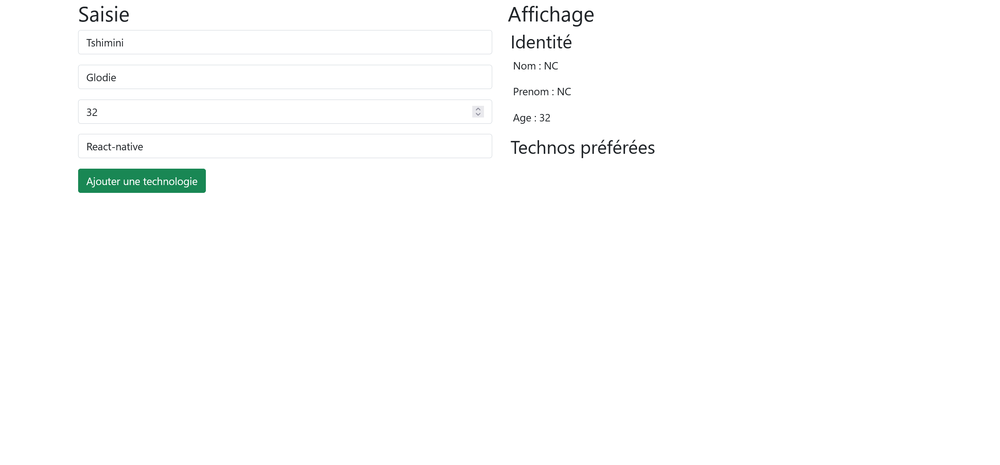

# Atelier 3.1 : la réactivité

## Enoncé

1. Créez un nouveau projet VueJS
2. Créez 2 composants, un pour la saisie et l'autre pour l'affichage [cf. illustration ci-dessous](#illustration)

### Spécifications techniques

- L'affichage du nom, prénom et âge s'effectuent en direct (lorsqu'on saisit l'info à gauche, à droite l'info est directement visible)
- Les technos est un tableau
- Si l'âge est supérieur ou égal à 18 ans, affichez le message "Vous êtes majeur(e)", sinon affichez "Vous êtes mineur(e)"
- La phrase sur l'évaluation de l'âge contient du HTML `
Vous êtes <strong>[majeur(e)|mineur(e)]</strong>
`
- Une techno est ajoutée à partir du clic sur le bouton

---

## Bonus

3. Refactorisez le [projet précédent sur le panier](./3.1.md) en ajoutant la réactivité.

---

## Illustration

