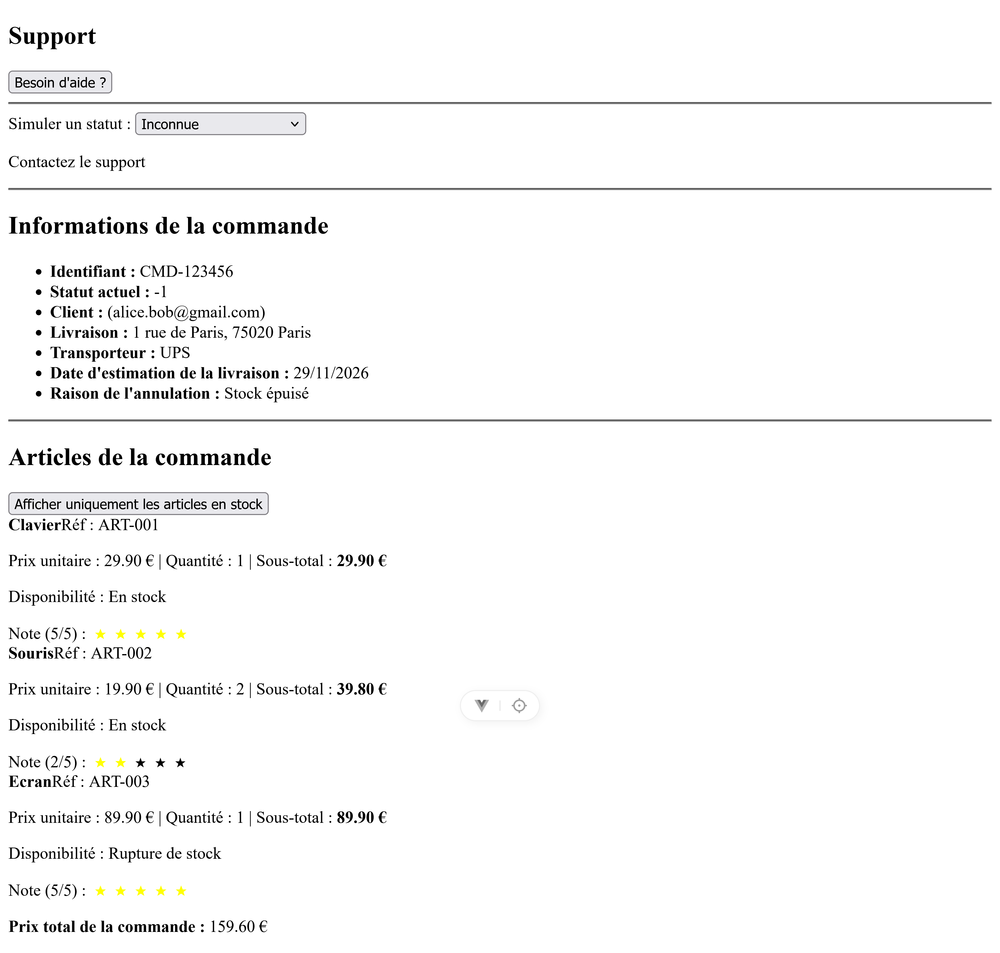

## Atelier : compile des ateliers 4.1, 5.1 et 6.1

### Étape 1 : Structure de base et Données réactives (`reactive`)

1. Créez un composant Vue avec un bloc `<script setup>`.
2. Importez `ref`, `reactive` et `computed` depuis `vue`.
3. Déclarez un objet réactif nommé `order` contenant les informations suivantes :
* Un identifiant de commande (ex: `'CMD-123456'`).
* Un statut initial (ex: `'shipped'`).
* Un objet client (`firstname`, `lastname`, `email`).
* Une adresse de livraison, un transporteur (`'UPS'`).
* Une date de livraison estimée calculée automatiquement à partir de la date du jour plus 5 jours (formatée en français avec `.toLocaleDateString('fr')`).
* Une raison d'annulation (`'Stock épuisé'`).
* Un tableau `items` contenant au moins 3 articles (chaque article doit avoir une référence, un nom, un prix, une quantité, un booléen `inStock` et une note `rating`).

4. Déclarez deux états booléens avec `ref` : `showHelp` (initialisé à `false`) et `onlyInStock` (initialisé à `false`).

---

### Étape 2 : Gestion de l'aide et simulation des statuts (Template)

1. **Section En-tête (Header) :**
* Ajoutez un bouton permettant de basculer (toggle) la visibilité de l'aide (`showHelp`). Le texte du bouton doit s'adapter ("Besoin d'aide ?" ou "Masquer l'aide").
* Affichez conditionnellement un bloc d'aide contenant l'identifiant de la commande si `showHelp` est vrai.

2. **Section Simulation de statut :**
* Créez un élément `<select>` lié en double sens (`v-model`) à `order.status` permettant de choisir entre différents statuts : `pending`, `paid`, `shipped`, `delivered`, `cancelled` (et une option invalide `-1`).
* Créez une propriété calculée (`computed`) nommée `statusMessage` qui retourne un message textuel différent selon la valeur de `order.status` (utilisez un `switch/case`).
* Affichez ce message sous le sélecteur.
* Ajoutez un affichage conditionnel (`v-if`) si le statut est `'cancelled'` (texte en rouge) et un autre si le statut est `'shipped'` affichant le transporteur et la date de livraison estimée (texte en vert).

---

### Étape 3 : Informations générales et Gestion des articles

1. **Informations de la commande :**
* Affichez sous forme de liste à puces (`<ul>`/`<li>`) les informations globales de la commande (ID, statut, client, adresse, transporteur, date, etc.).

2. **Liste des articles :**
* Ajoutez un bouton permettant de filtrer l'affichage pour basculer la variable `onlyInStock` (afficher tous les articles ou uniquement ceux en stock).
* Créez une propriété calculée `inStockItems` qui filtre le tableau `order.items` pour ne garder que les articles disponibles.
* Créez une propriété calculée `displayedItems` qui retourne soit `inStockItems`, soit `order.items` selon l'état de `onlyInStock`.
* Parcourez `displayedItems` avec un `v-for` pour afficher chaque article (nom, référence, prix unitaire, quantité, sous-total calculé, et statut de stock).

---

### Étape 4 : Système de notation et Prix total

1. **Notation par étoiles :**
* Pour chaque article, affichez une série de 5 boutons en forme d'étoile (`★`).
* Utilisez une classe dynamique (`:class="{ active: star <= item.rating }"`) pour colorer les étoiles correspondant à la note de l'article.
* Au clic sur une étoile, appelez une fonction `setItemRating(reference, rating)` qui recherche l'article correspondant et met à jour sa note (prévoir une validation pour que la note reste comprise entre 1 et 5).

2. **Prix total :**
* Créez une propriété calculée `totalPrice` qui additionne le produit du prix par la quantité de tous les articles de la commande.
* Affichez ce prix total formaté avec 2 décimales dans le pied de page (`<footer>`).

---

### Étape 5 : Styles CSS (`<style scoped>`)

Ajoutez les classes CSS nécessaires pour :

* Mettre le texte en rouge (`.red`) ou en vert (`.green`).
* Mettre en valeur les étoiles actives (`.active` : couleur jaune, texte en gras).
* Retirer les bordures et fonds par défaut des boutons de notation.

---

## Étape 6 : ajoutez des images

Ajoutez des images aux articles.

---

## Illustrations

